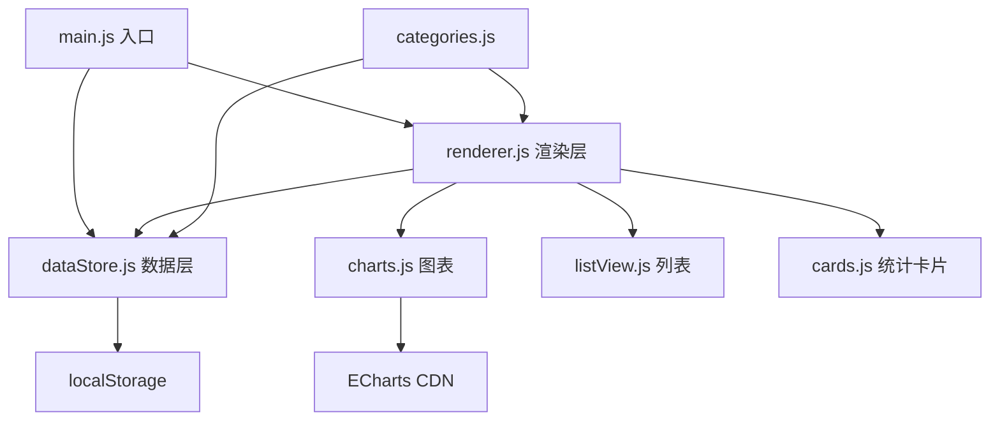

# Architecture Spine — Personal Expense Dashboard

## Design Paradigm

单文件原生 JavaScript 单页应用（Vanilla JS SPA）。无框架、无构建步骤、无后端。ECharts 通过 CDN 引入，localStorage 作为唯一数据层。

页面加载顺序：HTML 结构 → ECharts CDN → 业务 JS（数据层 → 渲染层 → 事件绑定）。

## Invariants & Rules

### AD-1 — 数据层隔离

- **Binds:** FR-10 (持久化), FR-11/12 (JSON 备份), FR-13 (清空), 所有读写操作
- **Prevents:** UI 组件直接操作 localStorage 导致散落式存储和难以维护
- **Rule:** 所有数据读写必须通过 `dataStore.js` 模块暴露的接口：`dataStore.getAll()`, `dataStore.add(expense)`, `dataStore.delete(id)`, `dataStore.exportJSON()`, `dataStore.importJSON(str)`, `dataStore.clear()`。localStorage key 统一为 `expense_dashboard_data`。

### AD-2 — 渲染触发链单向流动

- **Binds:** FR-1 (录入后刷新), FR-3 (删除后刷新), FR-9 (筛选后刷新)
- **Prevents:** 各图表/卡片手动调用各自刷新逻辑，导致刷新遗漏或顺序错乱
- **Rule:** 数据变更后统一调用 `renderer.refreshAll()`，由 renderer 协调各子组件（图表、列表、卡片）的刷新顺序。子组件不直接监听数据层变化。

### AD-3 — 类别颜色映射稳定

- **Binds:** FR-2 (类别), FR-4 (环形图颜色), FR-8 (列表标签颜色)
- **Prevents:** 同一类别在不同图表/列表里出现不同颜色，或每次加载颜色随机
- **Rule:** 预置 7 个类别各自固定颜色（在 `categories.js` 中定义）；自定义类别按创建顺序从色板中取剩余颜色。颜色映射在应用生命周期内固定。

### AD-4 — 依赖方向



规则：`charts.js`、`listView.js`、`cards.js` 只被 `renderer.js` 调用，不互相依赖；`dataStore.js` 只依赖 localStorage，不依赖任何 UI 模块。

## Consistency Conventions

| Concern | Convention |
| --- | --- |
| Naming | 文件名：kebab-case（`data-store.js`）；变量/函数：camelCase；常量：UPPER_SNAKE_CASE；CSS 类：kebab-case；Expense ID：Date.now() + 随机后缀（数字字符串） |
| Data format | 日期统一 `YYYY-MM-DD`（ISO 本地格式）；金额为浮点数（元）；JSON 版本号字段 `schema_version: 1` |
| Error handling | localStorage 不可用时，所有写操作捕获异常并在控制台 warn，页面不崩溃；JSON 导入格式错误时弹 alert 提示 |
| Validation | 金额 > 0；类别非空；日期合法；备注 ≤ 100 字。校验失败时禁用提交按钮 |

## Stack

| Name | Version |
| --- | --- |
| 语言 | ES2020 (原生 JS，type="module") |
| 图表库 | ECharts 5.x (CDN 引入) |
| 样式 | 原生 CSS 3，无框架 |
| 数据存储 | browser localStorage |
| 构建 | 可选：`npx serve` 本地预览；或直接 file:// 打开 |
| 浏览器 | Chrome 90+ / Edge 90+ / Firefox 88+ |

## Structural Seed

```
WEILAI_BYSJ_X/
├── _bmad-output/                 # BMAD 产物（不受此架构约束）
├── src/
│   ├── index.html                 # 入口 HTML，CDN 引入 ECharts
│   ├── css/
│   │   └── style.css              # 全部样式
│   └── js/
│       ├── categories.js          # 类别定义与颜色映射
│       ├── data-store.js          # 数据层：localStorage 读写 + JSON 导入导出
│       ├── charts.js              # 三张 ECharts 图表封装
│       ├── list-view.js           # 开销列表渲染 + 筛选
│       ├── cards.js               # 三张统计卡片渲染
│       ├── form.js                # 录入表单 + 校验
│       ├── renderer.js            # 统一刷新协调器
│       └── main.js                # 入口：DOM ready 后初始化
└── AGENTS.md / README.md / .gitignore
```

## Capability → Architecture Map

| Capability (FR) | Lives in | Governed by |
| --- | --- | --- |
| FR-1 录入表单 | `js/form.js` + `js/data-store.js` | AD-1, 校验约定 |
| FR-2 预置/自定义类别 | `js/categories.js` + `js/form.js` | AD-3 |
| FR-3 删除开销 | `js/list-view.js` + `js/data-store.js` + `js/renderer.js` | AD-1, AD-2 |
| FR-4 环形图 | `js/charts.js` (renderCategoryPie) | AD-4, 颜色约定 |
| FR-5 柱状图 | `js/charts.js` (renderMonthBar) | AD-4 |
| FR-6 折线图 | `js/charts.js` (renderTrendLine) | AD-4 |
| FR-7 统计卡片 | `js/cards.js` | AD-2 |
| FR-8 列表展示 | `js/list-view.js` | AD-3 |
| FR-9 类别筛选 | `js/list-view.js` + `js/renderer.js` | AD-2 |
| FR-10 localStorage | `js/data-store.js` | AD-1 |
| FR-11/12 JSON 导入导出 | `js/data-store.js` | AD-1, 数据格式约定 |
| FR-13 清空 | `js/data-store.js` | AD-1 |

## Deferred

| Decision | Reason it can wait |
| --- | --- |
| 是否引入 Vite 构建 | 当前纯 HTML 打开即可运行，构建步骤只在需要优化或打包时才有意义 |
| 编辑已录入开销 | v1 用"删除重录"代替，编辑意味着引入 form 双向绑定，工作量增加但价值小 |
| 深色模式 | 纯 CSS 变量可快速加，但不属于核心演示路径 |
| PWA / 离线安装 | localStorage 本身已离线可用，PWA 加的是安装体验，非必要 |
